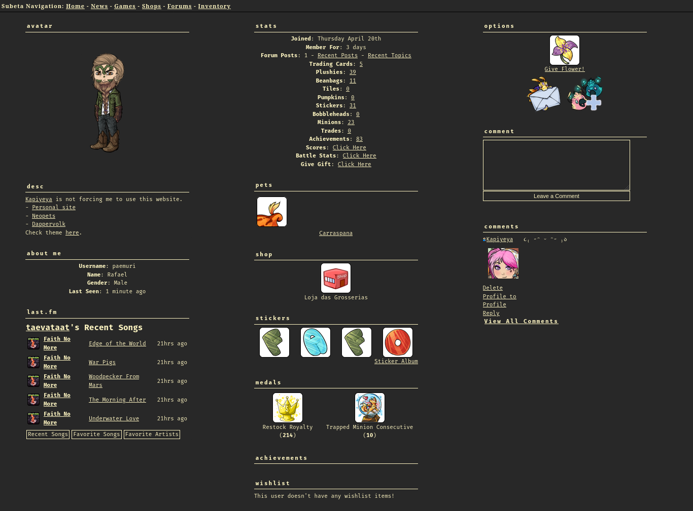
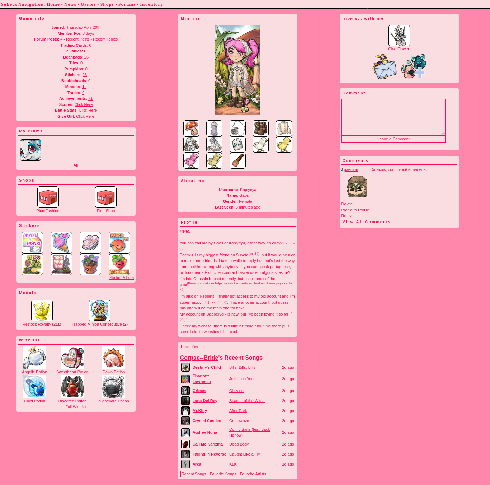

# Subeta profile

[![License][badge-1-img]][badge-1-link]

Small custom CSS theme for Subeta profiles. See examples: [paemuri][1]
and [Kapiyeya][2].

To use it, simply add the content of [`profile.css`][3] into your profile
description, inside of a `<style>` tag. Don't forget to change the
variables' values.

## Examples

[][1]

[][2]

## Source code

The main repository is on [SourceHut][source-srht]. Mirrors exist on
[Codeberg][source-codeberg] and [GitHub][source-github] for convenience, but
they might occasionally be outdated.

## License and contribution

All original code is licensed under the
[GNU Affero General Public License 3.0 or later][license-code].

Unless you explicitly state otherwise, any contribution intentionally submitted
for inclusion in the work by you shall be licensed under the same license as
the material to which it is contributed, without any additional terms or
conditions.

### Third-party and exceptions

The images in `static/` are screenshots of Subeta profiles using this theme.
They contain third-party content and are included only as documentation; they
are not covered by this project's license.

[1]: https://subeta.net/users/paemuri
[2]: https://subeta.net/users/Kapiyeya
[3]: ./profile.css

[badge-1-img]: https://img.shields.io/badge/license-AGPL--3.0--or--later-green?style=flat-square
[badge-1-link]: ./LICENSE

[source-srht]: https://git.sr.ht/~paemuri/subeta-profile
[source-codeberg]: https://codeberg.org/paemuri/subeta-profile
[source-github]: https://github.com/paemuri/subeta-profile

[license-code]: ./LICENSES/AGPL-3.0-or-later.txt
